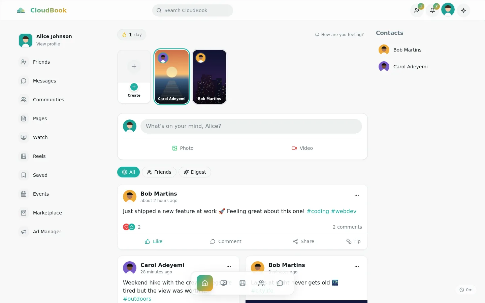
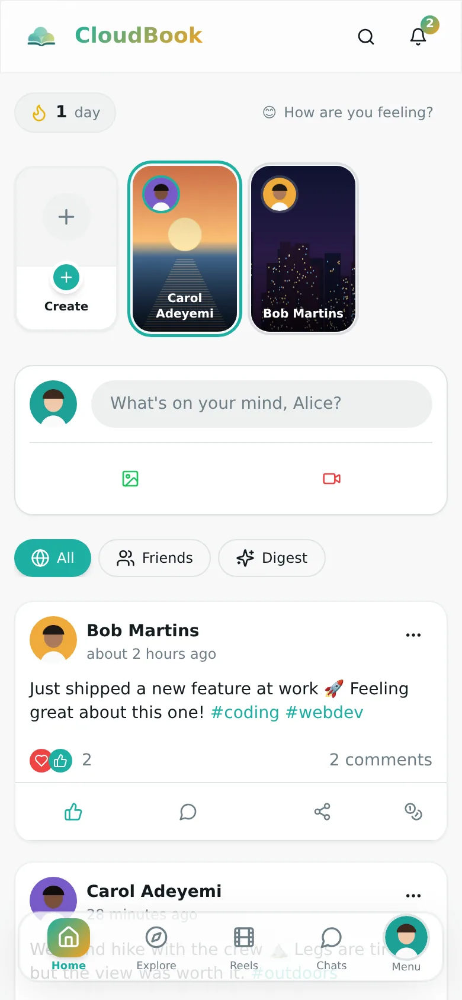
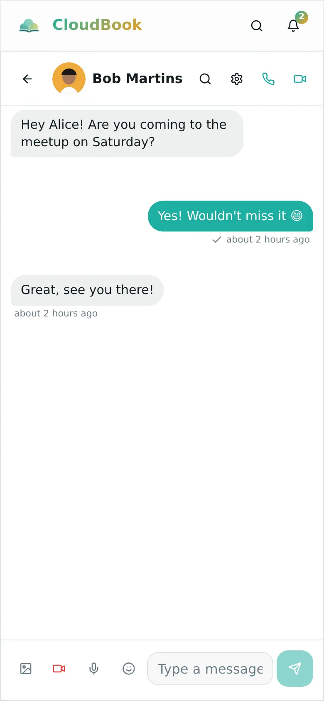
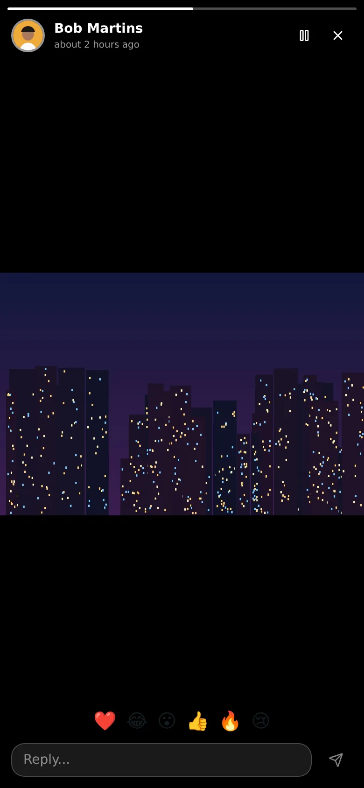
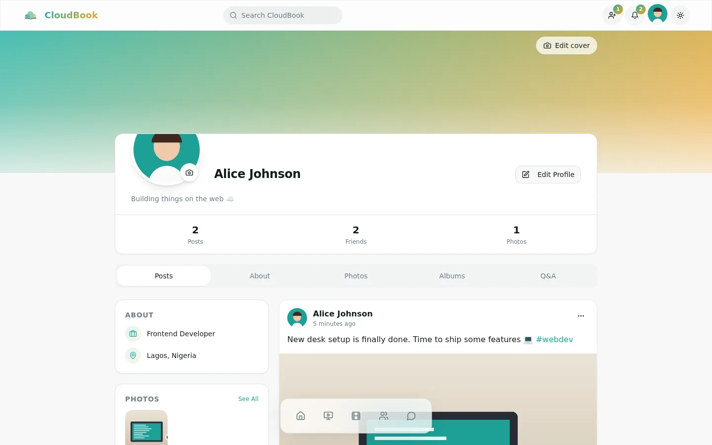
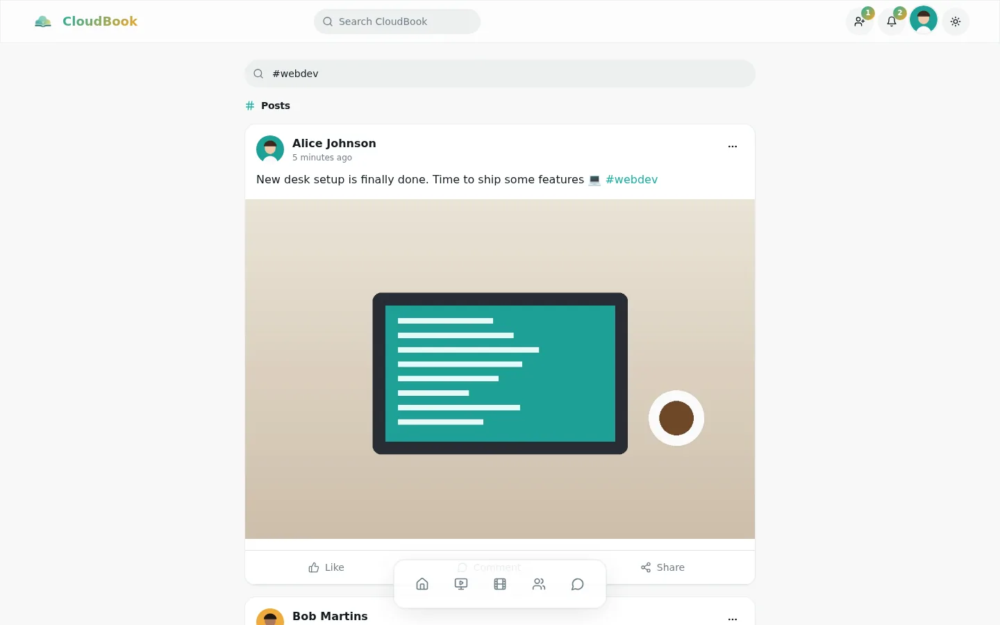
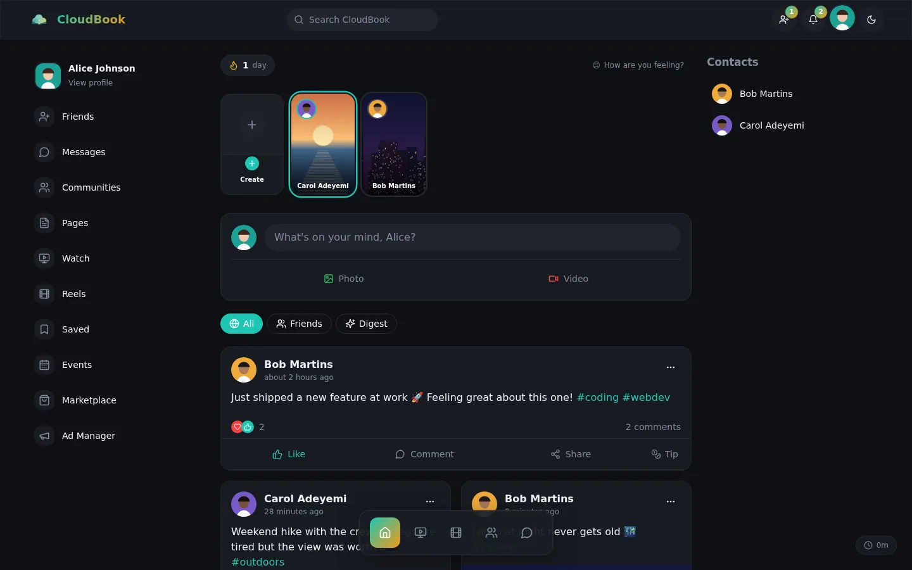

# CloudBook

A full-featured social network: feed, stories, real-time chat, voice and video calls, communities and an AI companion, in one responsive web app that works on phones and desktops, in light and dark mode.



<table>
  <tr>
    <td></td>
    <td></td>
    <td></td>
  </tr>
</table>

## Features

- **Feed:** posts with photos, galleries, video and polls; reactions, threaded comments, shares, saved posts, @mentions and #hashtags; ranked "All", "Friends" and "Digest" views.
- **Stories and reels:** 24-hour stories with views, reactions and replies; full-screen vertical reels.
- **Messaging:** real-time one-to-one chat with typing indicators, read receipts, replies, edits, reactions, photos, voice notes, GIFs and disappearing messages.
- **Calls:** one-to-one and group voice/video calls over WebRTC that ring on any page, with screen sharing, mute indicators and a minimized window you can drag around while you keep using the app.
- **Communities:** groups with chat, voice rooms and posts; pages with followers; events with RSVPs.
- **Discovery:** Explore with trending topics and search across people and posts.
- **More:** a marketplace, watch videos, creator tips and subscriptions, ads manager, achievements and login streaks, and CloudBuddy (an AI chat companion).
- **Polish:** works from 360px phones to wide desktops, light and dark themes, an installable PWA, and inputs that stay above the on-screen keyboard.

| Profile | Explore | Dark mode |
| --- | --- | --- |
|  |  |  |

## Tech stack

- **Frontend:** React 18, TypeScript (strict), Vite, Tailwind CSS, shadcn/ui (Radix), TanStack Query, React Router, Framer Motion
- **Backend:** Supabase: Postgres with row-level security, Auth (email and Google), Storage, Realtime, and Edge Functions (Deno)
- **Calls:** WebRTC, with Supabase Realtime for signalling
- **Hosting:** Vercel (the site) and Supabase (database, sign-in, storage, server functions)

## Engineering notes

- **Security in the database.** Every table is protected by row-level security policies. Edge functions check who is calling: the AI chat requires a signed-in user, and the notification function only accepts server-side calls.
- **One auth gate.** A single route guard with a shared session protects every signed-in page. Visitors are sent to sign in and returned to the page they wanted afterwards.
- **Realtime without leaks.** Every live subscription is cleaned up when its screen closes. Effects use a `useEffectEvent` helper so they re-run only when their real inputs change, never in loops.
- **Fast on phones.** The app shell stays small and pages load lazily. Shared icons are bundled together, images are sized WebP, fonts don't block the first paint, and per-post lookups are batched into single queries.
- **Responsive by measurement.** Every page is checked at 360, 768, 1024 and 1440px for overflow and cramped layouts.

## Local development

Requirements: Node.js 20+. The `.env` file points the app at the Supabase project (its public anon key only).

```sh
npm ci
npm run dev            # http://localhost:8080
```

| Command | What it does |
| --- | --- |
| `npm run dev` | Start the dev server |
| `npm run build` | Production build into `dist/` |
| `npm run lint` | ESLint |
| `npm run typecheck` | TypeScript (strict mode) |

Changes merged into `main` deploy to Vercel automatically.

### Optional settings

GIF search in chat uses Tenor (falling back to Giphy) with built-in default keys. To use your own keys, add them to `.env`:

```sh
VITE_TENOR_API_KEY="..."
VITE_GIPHY_API_KEY="..."
```

Calls connect devices directly when they can. Across mobile networks and strict firewalls they need a TURN relay (for example from Metered, Cloudflare Calls or Twilio). The relay login is kept secret: the `turn-credentials` backend function gives it only to signed-in users when a call starts. Add these secrets in Supabase → Edge Functions → Secrets (or with `supabase secrets set`):

| Secret | Value |
| --- | --- |
| `TURN_USERNAME` | The relay username |
| `TURN_CREDENTIAL` | The relay password |
| `TURN_URLS` | Optional, comma-separated relay addresses. Defaults to Metered's global relay |

### Database updates

Schema changes live in `supabase/migrations/`. If the hosted database doesn't pick them up automatically, run the newest files in the SQL editor, oldest first. For example:

- `20261004150000_voice_room_creator_can_end.sql`: lets a voice room's creator end it.
- `20261005090000_fix_notification_triggers.sql`: stops duplicate notifications and notifies people when someone reacts to their post.
